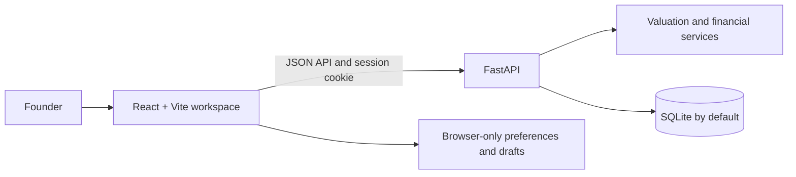

<div align="center">

# Startup Valuation

### A clearer view of your startup's value—and the assumptions behind it.

An interactive founder workspace for model-based startup valuation, practical financial planning, and execution roadmaps.

<p>
  
  
  
  
  
</p>

</div>

> **Important:** Valuations and financial projections are estimates based on user-provided inputs and disclosed model assumptions. They are not certified appraisals, investment advice, or guarantees.

## What it does

Startup Valuation brings early-stage planning tools together in one founder-focused workspace:

- **Valuation:** a guided profile, financials, business, and market intake followed by a deterministic estimate, method breakdown, assumptions, and financial signals.
- **Financial planning and runway:** editable monthly forecasts with revenue, costs, net cash flow, and closing cash.
- **Fundraising and cap table:** basic priced-round dilution and ownership calculations.
- **Investor readiness and reports:** a founder checklist plus owner-scoped report history and on-demand PDF downloads.
- **Startup roadmaps:** deterministic, editable plans tailored to business type and stage. Roadmap generation is a template-based draft, not an AI service.
- **Founder workspace and settings:** account-backed report access alongside clearly identified browser-only preferences.

## Product architecture



The valuation engine uses founder-entered figures and illustrative stage revenue multiples; it does not fetch or invent comparable-company data. Forecasts are scenario estimates, not verified actuals. The roadmap builder creates an editable draft in the current page session and does not persist roadmaps.

## Get started

### Requirements

- Python 3.10 or later
- Node.js 18 or later

### 1. Install backend dependencies

Run these commands from the repository root in PowerShell:

```powershell
py -m venv .venv
.\.venv\Scripts\python.exe -m pip install -r requirements.txt
```

### 2. Prepare the database

Back up any existing database before applying migrations. Then run:

```powershell
Set-Location .\backend
..\.venv\Scripts\python.exe -m alembic -c ..\alembic.ini upgrade head
```

For a fresh database, this creates the schema. Existing valuation rows are intentionally left unowned; ownership is never guessed or backfilled.

### 3. Start the API

In a PowerShell window:

```powershell
Set-Location .\backend
..\.venv\Scripts\python.exe -m uvicorn main:app --reload --host 127.0.0.1 --port 8000
```

The API health check and interactive docs are available at `http://localhost:8000/api/health` and `http://localhost:8000/api/docs`.

### 4. Start the frontend

In a second PowerShell window:

```powershell
Set-Location .\frontend
npm ci
npm run dev
```

Open `http://localhost:5173`. Vite proxies `/api` requests to `http://127.0.0.1:8000`. Set `VITE_API_PROXY_TARGET` to use a different backend; `VITE_API_BASE_URL` can configure a direct API base URL.

## Environment configuration

The backend reads environment variables (or a local `.env` file) from its working directory. Copy `.env.example` to `backend/.env` only if you need to customize local settings. Never commit `.env` files or real credentials. The valuation calculation and roadmap templates do not require an LLM API key.

For production, set `ENVIRONMENT=production`, `DEBUG=false`, and explicit HTTPS-only `CORS_ORIGINS`. Configure secret management, TLS, database access controls, backups, tested restoration, retention, monitoring, and shared rate limiting before accepting real customer data.

## Routes and API

| Area | Route |
| --- | --- |
| Public site | `/` |
| Valuation | `/valuation` |
| Roadmap landing and intake | `/roadmap`, `/roadmap/new` |
| Founder workspace | `/app` |
| Financial planner and runway | `/app/financial-planner`, `/app/runway` |
| Reports and settings | `/app/reports`, `/app/settings` |

| Method | Endpoint | Purpose |
| --- | --- | --- |
| `GET` | `/api/health` | Backend health |
| `POST` | `/api/auth/register` | Register and start a session |
| `POST` | `/api/auth/login` | Authenticate and start a session |
| `GET` | `/api/auth/me` | Read the current user and CSRF token |
| `POST` | `/api/auth/logout` | Revoke the current session |
| `POST` | `/api/valuation/calculate` | Calculate and save an owned valuation |
| `GET` | `/api/valuation/{id}` | Retrieve an owned saved valuation |
| `GET` | `/api/reports` | List the signed-in user's reports |
| `GET` | `/api/reports/{id}` | Read an owned report and its assumptions |
| `GET` | `/api/reports/{id}/pdf` | Generate an owned PDF on demand |
| `DELETE` | `/api/reports/{id}` | Delete an owned report and valuation |

Valuation requests contain `profile`, `financials`, `business`, and `market` objects. `stage` must be one of `idea`, `pre_seed`, `seed`, `series_a`, `series_b`, or `series_c_plus`; `business_model` must be one of `saas`, `marketplace`, `ecommerce`, `fintech`, `edtech`, `healthtech`, or `other`. Market sizes are entered in INR crore and must satisfy `TAM >= SAM >= SOM`.

## Valuation and forecast assumptions

Revenue methods use annual revenue (or monthly revenue × 12 when annual revenue is absent) and an illustrative stage multiple. A growth-adjusted method applies a configured premium; a Berkus-inspired estimate is used for pre-revenue startups. The base is the simple average of applicable methods, excluding the market-ceiling method, which is a sanity cap of 25% of submitted SOM. Low and high scenarios are 75% and 135% of base.

Where inputs allow, the response also includes financial-health, growth, investor-readiness, runway, and LTV/CAC signals. These are model-derived indicators, not independent diligence.

Financial planner and runway inputs, settings, readiness checklists, and roadmap drafts are not persisted to the backend. Currency settings change display formatting only; they do not convert values or change valuation calculations. Forecasts compound entered monthly revenue and total expenses by their respective monthly growth assumptions. Net cash flow is revenue minus operating expenses, payroll, marketing, and other costs; closing cash carries forward. Projections exclude taxes, financing changes, working capital, and seasonality.

## Security and production limitations

- Authentication uses Argon2 password hashes and opaque, revocable database-backed sessions. Session cookies are HttpOnly and SameSite Strict; state-changing authenticated requests require a CSRF token and trusted Origin.
- New valuation reports are owner-scoped. Legacy records without an owner remain unowned and are not exposed in report history.
- Settings and several founder tools are browser-local or session-only. Roadmaps are not persisted and the roadmap workspace does not expose private records.
- Email verification, password recovery, account deletion, organization isolation, production backups, and infrastructure provisioning are not included.
- SQLite is the default local database. Review deployment security and data-retention requirements before using real customer data.

## Tests

From the repository root:

```powershell
.\.venv\Scripts\python.exe -m pytest backend\tests -q
Set-Location .\frontend
npm test
npm run build
```

## License

No license has been specified. Public repository visibility does not grant permission to reuse, distribute, or modify this project.
