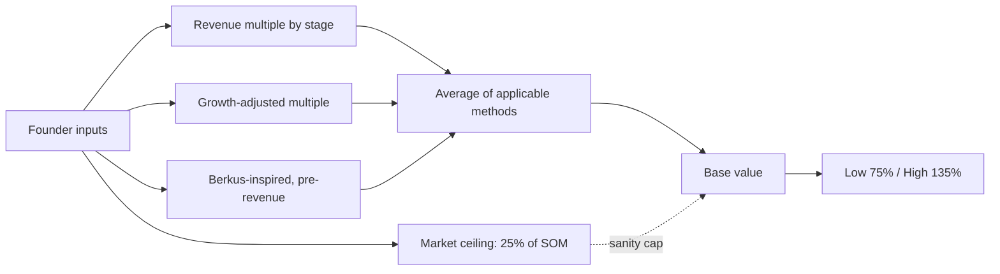
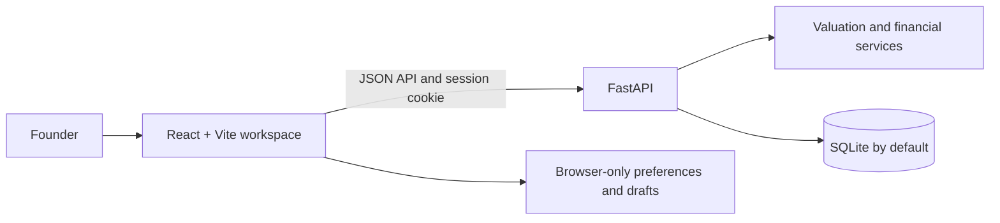

<div align="center">


### Know what your startup is worth, and exactly why.

A full-stack founder workspace for model-based valuation, financial planning, runway, fundraising, and execution roadmaps.

<p>
  
  
  
  
  
  
</p>

<p>
  <a href="https://github.com/priyanshu-king/startup-valuation-platform/actions"></a>
  
  
</p>

<p>
  <a href="#-features">Features</a> ·
  <a href="#-architecture">Architecture</a> ·
  <a href="#-quick-start">Quick start</a> ·
  <a href="#-api-at-a-glance">API</a> ·
  <a href="#-security">Security</a> ·
  <a href="#-tests">Tests</a>
</p>

</div>

> **Important:** Valuations and financial projections are estimates based on user-provided inputs and disclosed model assumptions. They are not certified appraisals, investment advice, or guarantees.

---

## ✨ Features

| | Module | What you get |
| :-: | --- | --- |
| 📊 | **Valuation engine** | Guided profile, financials, business and market intake, then a deterministic estimate with method breakdown, assumptions and low/base/high scenarios. |
| 💸 | **Financial planner and runway** | Editable monthly forecasts: revenue, costs, net cash flow and closing cash. |
| 🤝 | **Fundraising and cap table** | Priced-round dilution and ownership calculations. |
| ✅ | **Investor readiness** | A founder checklist to see how prepared you are. |
| 📄 | **Reports and PDF** | Owner-scoped report history with on-demand PDF downloads. |
| 🗺️ | **Startup roadmaps** | Editable plans tailored to business type and stage (template-based drafts, not an AI service). |
| ⚙️ | **Workspace and settings** | Account-backed reports alongside clearly marked browser-only preferences. |

**Why it's different:** every number is traceable. The engine does not invent comparable-company data, and every assumption is shown next to the result.

## 🧠 How the valuation works



## 🏗️ Architecture



| Layer | Technology |
| --- | --- |
| Frontend | React 18, Vite, Tailwind CSS, React Router, React Hook Form + Zod, Recharts, Framer Motion, Three.js |
| Backend | FastAPI, Pydantic v2, SQLAlchemy 2, Alembic, SlowAPI rate limiting, ReportLab PDFs |
| Security | Argon2 hashing, revocable DB-backed sessions, CSRF protection |
| Delivery | GitHub Actions CI for backend tests, frontend tests and build |

## 🗂️ Project structure

```text
├── backend/
│   ├── api/          # routers and endpoints (auth, valuation, reports, health)
│   ├── core/         # config, security, rate limiting
│   ├── models/       # SQLAlchemy models
│   ├── schemas/      # Pydantic schemas
│   ├── services/     # valuation and report logic
│   ├── alembic/      # database migrations
│   └── tests/        # pytest suite
├── frontend/src/
│   ├── components/   # landing, valuation wizard, workspace tools, UI kit
│   ├── pages/        # routes
│   └── services/     # API client and financial calculations
└── .github/workflows # CI
```

The valuation engine uses founder-entered figures and illustrative stage revenue multiples; it does not fetch or invent comparable-company data. Forecasts are scenario estimates, not verified actuals. The roadmap builder creates an editable draft in the current page session and does not persist roadmaps.

